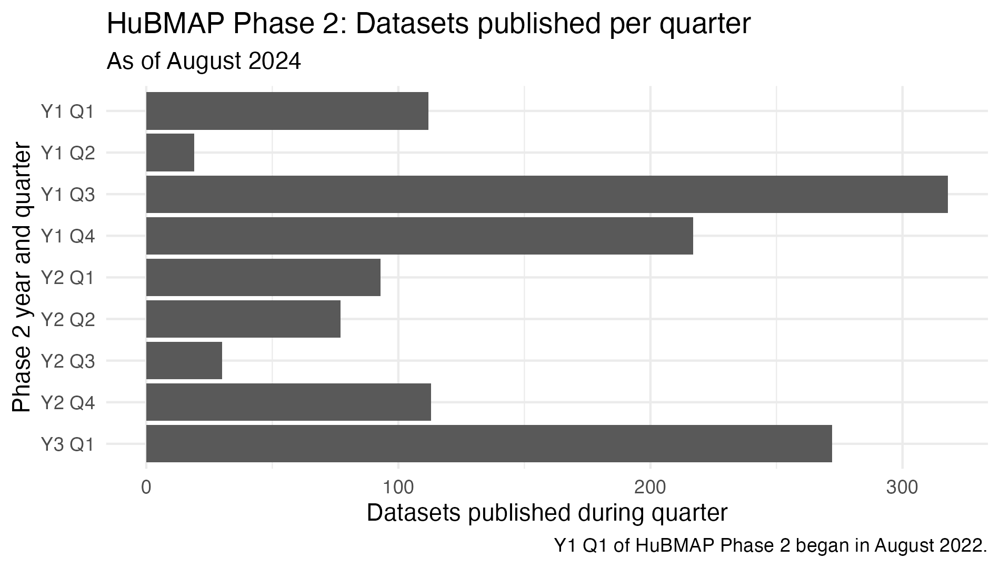
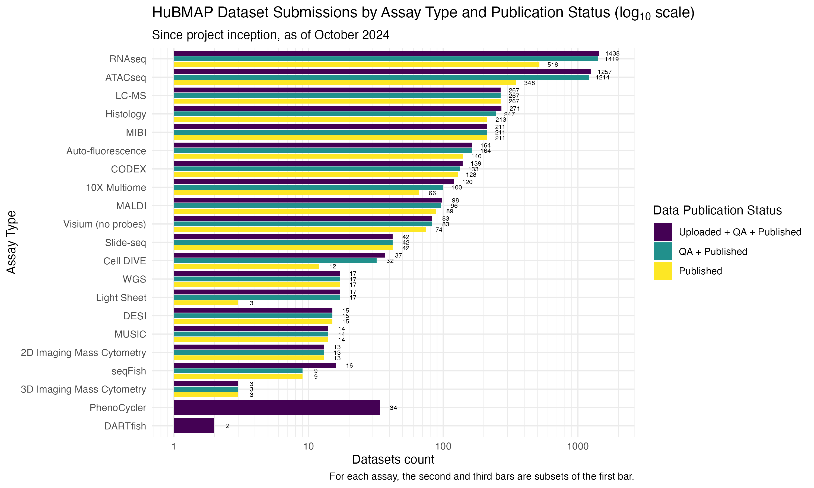
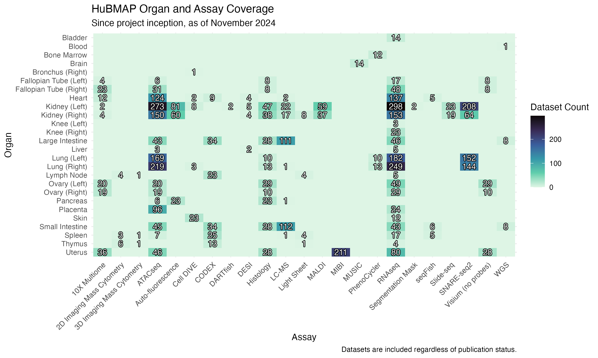
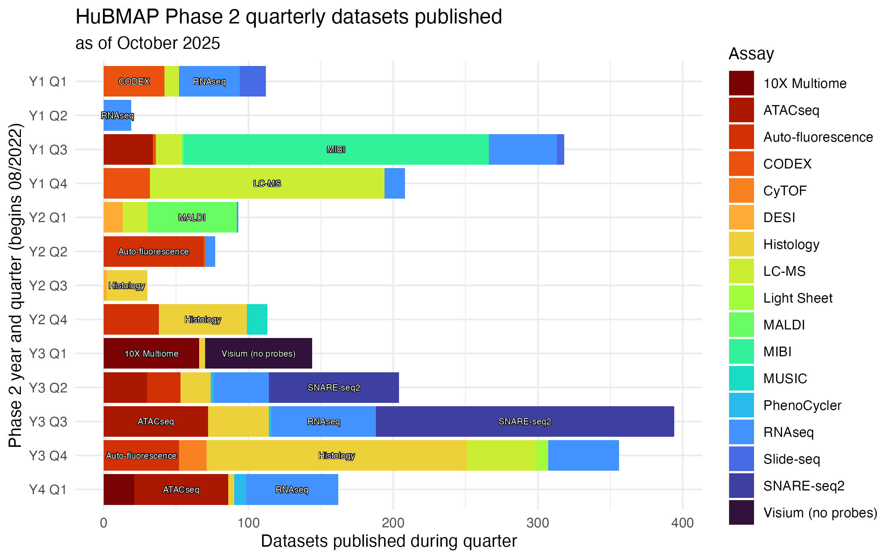

This post will highlight some of the data visualizations I have created for the [HuBMAP](https://hubmapconsortium.org/) and [SenNet](https://sennetconsortium.org/) data repositories for consortial reporting. The information is not up-to-date (although was accurate at the time of reporting), and the focus in this post is meant to be on the requirements and choices made rather than the data content itself. Requirements were provided by the project's principle investigator (PI) who also collected input from other stakeholders.

I was allowed to use any available tool, so I chose [ggplot2](https://ggplot2.tidyverse.org/index.html), an [R](https://www.r-project.org/) package, and [dplyr](https://dplyr.tidyverse.org/) for needed data transformations. ggplot2 produces attractive, [Tufte](https://www.edwardtufte.com/book/the-visual-display-of-quantitative-information/)-inspired, legible results (in my opinion), offers a great deal of control and extensibility, and is saveable as text code for reproduction or alteration later. In general I was given latitude on the types of plots, and the requirement(s) were usually stated as a question rather than a specific plot type. As explained below, I chose the plot types based on the desired information, properties of the data, and tradeoffs. However, the process was also iterative in that the PI provided feedback on initial drafts, I adjusted accordingly and shared a new draft, and so on until the PI was satisfied.

## My requirements

In addition to the specific requirement(s) to be met in each plot, I imposed my own professional requirements on all of the work as well:

- adhering to [data visualization best practices](https://clauswilke.com/dataviz/) and especially avoiding pitfalls
- [colorblind-friendly](https://clauswilke.com/dataviz/color-pitfalls.html#not-designing-for-color-vision-deficiency) (I prefer the [Viridis palettes](https://cran.r-project.org/web/packages/viridis/vignettes/intro-to-viridis.html))
- legible and sufficiently labeled
- image ratio similar to presentation slide (16:9), to utilize screen area as much as possible while presenting on Zoom

Without further ado, let's look at some plots.

## How many datasets published per quarter?

A straightforward question, but this basic plot became the foundation for a later important plot. Since the data are counts of datasets in a quarter (which is a categorical variable), a bar plot made the most immediate sense. I like the landscape orientation for bar charts because the category labels are easier to read/manage on the y axis, and in this case especially because my target ratio was \~16.9. Unless there were very many quarters (there weren't), orienting the plot landscape made more sense.

I took care to order the quarters chronologically and to annotate when Y1 Q1 began for context. The consortium-specific quarters had to be parsed from strings like "October 4, 2024" and then summarized prior to plotting.

{fig-align="center"}

## How many datasets of each assay type, and what are their publication statuses?

We have quickly gone to a more complicated plot. Information of interest was: for each assay type, how many datasets have we published, as compared to how many have been uploaded but not yet published?

A bar plot is still one of the best options here (counts of categories). However, there are several challenges:

- 21 assay types (categories) makes for a long axis—putting the categories on the y-axis is a must

- For each of the 21 categories, there is an additional "status" variable of three levels (Uploaded + QA + Published; QA + Published; and Published). This was a way to show the absolute numbers as well as the subsets of interest. The goal became for the "Published" subset, the yellow bar, to "fill up" to the same level as the other two bars of that assay type, i.e., that everything submitted would be published. While a stacked bar chart would have theoretically worked here, in practice it would have also created some miniscule and illegible segments of data that would provoke additional questions.

- Since there was a great range in the counts (max = 1436, min = 2), a linear scale on the x-axis would not work. The PI suggested that I try a logarithmic scale, and this worked well. Number labels were also requested to aid legibility along such a long y-axis.

While this has led to a complicated chart with some arguably redundant information (the "status" subsets), I believe this plot "squares the circle" of expressing both absolute and relative numbers, for many categories with a large range of values, in a legible way.

{fig-align="center"}

## How many datasets for each organ and assay type?

The "coverage" of organ and assay types was another way of formulating this question. Each dataset has two categorical variables, organ and assay type, and the question was for a count of datasets in every combination of values (e.g., how many heart RNAseq, how many heart ATACseq, how many lung RNAseq, etc.).

While a grouped bar chart might be a first thought for counts of categorical combinations, this was unworkable because of the number of levels in each variable (21 assay types, 26 organs). This would require up to 546 bars total, which would of course be illegible and/or a poor use of space.

The solution is a tiled heatmap. Because the audience was interested in discussing precise counts, an overlay of the actual numbers was requested (and was very helpful for spotting very small categories). While previous plots sorted their y-axis on count, in this scenario we should alphabetize the labels on each axis for reasonable navigability.

{fig-align="center"}

## How many datasets published per quarter? pt. 2: what are their assay types?

We return to the first plot, adding assay type as another variable. The stacked bar plot allows the reader to easily see 1. the overall count for the quarter and 2. the relative size of assay categories.

A tradeoff is that it can be difficult to estimate the absolute count of one segment (e.g., LC-MS of Y2Q1), but this information was not deemed as important as the overall count and the relative composition of each quarter.

A challenge of this plot is the large number of colors (many kinds of assay type), sometimes creating ambiguity and/or a sense of straining. I attempted to mitigate this by labeling any category above a certain size (i.e., wide enough to hold a label), or labeling the largest category in the quarter if no category passed the width threshold. In an interactive setting, this could be practically solved with a tooltip functionality.

{fig-align="center"}

## Final thoughts

I hope this has shown some of what I can with data visualization and how I think about it.

Please [contact me](mailto:dominicbordelon@gmail.com) if you have any data viz needs you'd like to discuss!
